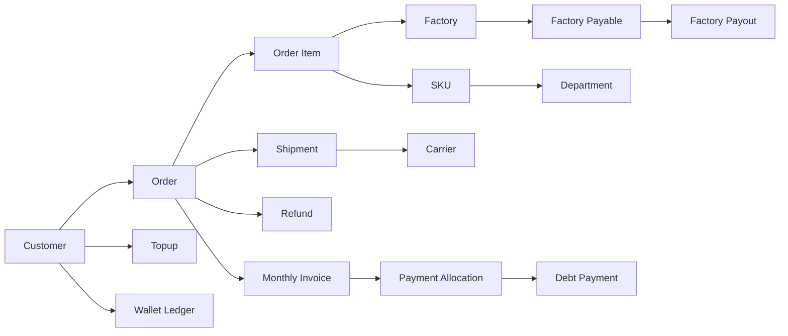

# DATA CONTRACT — Quick reference for Codex

All amounts are integer **USD cents**. Convert to display currency only at the boundary. Example: `total_charge_cents: 12999` displays `$129.99`.

## Core entity graph



## Finance consistency equations

```text
ORDER CHARGE = SUM(item.production_revenue) + SUM(shipment.shipping_revenue + shipment.tax_fee_revenue)
ORDER DIRECT COST = SUM(item.production_cost) + SUM(shipment.shipping_cost + shipment.tax_fee_cost + shipment.other_cost)
ORDER CONTRIBUTION PROFIT = ORDER CHARGE - ORDER DIRECT COST
REFUND PROFIT IMPACT = -REFUND AMOUNT + RECOVERED COST
INVOICE REMAINING = GROSS CHARGES - APPROVED REFUND CREDITS - APPROVED PAYMENT ALLOCATIONS
WALLET BALANCE = SUM(approved ledger credit/debit events for that customer)
DEBIT OUTSTANDING = MAX(0,-WALLET BALANCE)
FACTORY PAYABLE BALANCE = SUM(factory order item costs) - SUM(approved factory payouts)
```

## Date anchors

- `orders.created_at`: new Orders tab, booked order report
- `refunds.refund_date`: Refunds in Period tab
- `topups.approved_at`: cash posted (or created_at for pending queue)
- `wallet_ledger.event_date`: account balance as-of
- `debt_payments.payment_date`: recorded payment day
- `factory_payouts.payment_date`: actual factory disbursement
- `invoices.period_month`: billing month, not necessarily creation time

## Mock JSON cardinalities

Expect 16 Customers, 4 Factories, 4 Departments, 12 SKUs, 160 Orders, 192 Order Items, 183 Shipments, 30 Refunds, 32 Monthly Invoices, 36 Topups, 27 Debt Payment Records, 62 Payment Allocations, 16 Factory Payables, 20 Factory Payout Records. Use `expected_totals.json` for amounts.

## Explicit limitations

- Sample fixtures are illustrative, one invoice per debit order, but TypeScript must allow `invoice_ids[]` for future cases.
- Month of Production Cost in this fixture is approximated by Order date; backend will eventually supply correct cost posting and completed dates.
- VAT/pass-through tax is zero in fixtures; do not infer a tax compliance policy from them.
- Company overheads, COGS recognition and finalized statutory accounting are outside this frontend-only iteration.
